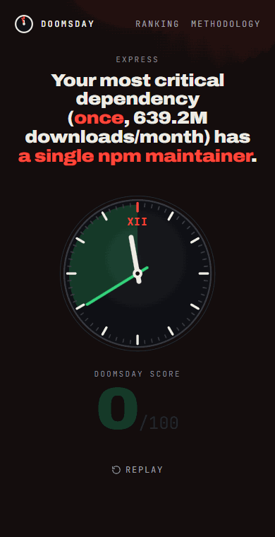

<div align="center">

# Dependency Doomsday

**How close is your project to midnight?**

Paste a `package.json` or a public GitHub repo and get a doomsday forecast of your npm dependencies.

[](https://dep-doomsday.vercel.app/r/github/Stephanoescu/dependency-doomsday)
[](LICENSE)

**[dep-doomsday.vercel.app](https://dep-doomsday.vercel.app)** · [Methodology](https://dep-doomsday.vercel.app/methodology) · [Who holds up the internet?](https://dep-doomsday.vercel.app/ranking)



</div>

In 2016, one developer unpublished **left-pad**, 11 lines of code, and builds broke across the internet.
In 2024, the exhausted lone maintainer of **xz** handed commit access to a stranger who planted a
backdoor. Dependency Doomsday checks each of your dependencies for the same kind of risk:

- is it **abandoned**?
- does it have **a single npm maintainer**?
- is it **critical**: a single maintainer and more than a million downloads a month?

You get a score from 0 to 100, a doomsday clock, the reasons behind every number, and the people worth
thanking. The result lives at a shareable link, with a share image and a README badge like the one
above.

- **Free:** public APIs only, on Vercel's free plan.
- **Rules, not AI:** a fixed, versioned and explainable methodology.
- **Private:** only package names are processed. Pasted files are parsed in your browser.
- **No sign-up**, no database.

## Add the badge to your README

```markdown
[](https://dep-doomsday.vercel.app/r/github/OWNER/REPO)
```

Or run a forecast and press **Copy badge**.

## How it works

1. **Input.** A pasted `package.json` is parsed in the browser. For a GitHub repo, the server reads
   `package.json` from `raw.githubusercontent.com` and keeps only the package names. Reading the file
   this way costs no GitHub API quota. Monorepos (workspaces, pnpm, Lerna) are detected and you're
   asked to point at a package.
2. **Evidence.** For each dependency (up to 150), the app collects three things:
   - **npm registry:** maintainers, release dates, deprecation, linked repository, dependency count
     and funding;
   - **npm downloads:** monthly downloads, fetched in bulk;
   - **GitHub:** last push, whether the repo is archived, and open issues.

   It runs at most 8 requests at a time, caches results for 24 hours, and a failing source never stops
   the analysis.
3. **Score.** Each package gets a risk from 0 to 100. The project score is 100 minus the
   download-weighted average risk. Minutes to midnight = score ÷ 10.
4. **Share.** Each result has its own link, which is recomputed from the cache when opened:
   - repos: `/r/github/owner/repo`;
   - pasted files: `/list?d=…`. These links hold package names only, and leave out any package npm
     couldn't find, since those are probably private.

   The link comes with a 1200×630 or 1080×1920 image and a shields-style badge.

## Methodology (v2)

| Rule                                                   | Risk points |
| ------------------------------------------------------ | ----------- |
| Deprecated or unpublished on npm, or repo archived     | = 100       |
| A single npm maintainer                                | +30         |
| Last release more than 36 months ago                   | +40         |
| Otherwise, last release more than 18 months ago        | +25         |
| No push to the GitHub repo in more than 24 months¹     | +15         |
| No linked repository                                   | +10         |

- **Discounts:** the release-age penalty is **halved** (once) for packages that look *possibly
  finished*, or when the repo had a push in the last 12 months. A package looks possibly finished when
  it has no dependencies of its own, fewer than 10 open issues, and isn't deprecated or archived.
- ¹ **Not for possibly finished packages:** their quiet repo is the same inactivity as their old
  release, so it's counted once (new in v2).
- **Cap and colors:** risk is capped at 100. Green is 0–29, yellow 30–59, red 60 and up.
- **Critical:** a single maintainer and more than 1M downloads a month. Critical packages weigh double
  in the project score.
- **Missing data:** packages without npm data are left out of the score. Packages without GitHub data
  are scored from npm alone and labeled as such.

The plain-language version lives at [`/methodology`](https://dep-doomsday.vercel.app/methodology).
The code is in [`lib/risk.ts`](lib/risk.ts), with tests and a sanity check against frozen real-world
data.

## Run it locally

Requires Node.js 20.9 or newer. No accounts or environment variables are needed.

```bash
git clone https://github.com/Stephanoescu/dependency-doomsday.git
cd dependency-doomsday
npm install
npm run dev          # http://localhost:3000
```

| Script                        | What it does                                                                     |
| ----------------------------- | -------------------------------------------------------------------------------- |
| `npm run dev`                 | Development server                                                               |
| `npm run build && npm start`  | Production build and server                                                      |
| `npm test`                    | Unit tests (Vitest)                                                              |
| `npm run lint` / `typecheck`  | ESLint / TypeScript                                                              |
| `npm run check:token`         | Confirms `GITHUB_TOKEN` is loaded and GitHub grants 5,000 requests/hour (never prints the token) |
| `npm run check:fit`           | Checks the result's first screen fits 390×844 and 360×740. Needs a running server and your installed Chrome. |
| `npm run fixtures:capture`    | Refreshes the real-world data behind the sanity test                             |
| `npm run sample:capture`      | Refreshes the sample forecast shown on the home page                             |

To use a token locally, create `.env.local` with `GITHUB_TOKEN=github_pat_…`, restart `npm run dev`, and check it with `npm run check:token`. Without a `GITHUB_TOKEN`, GitHub allows 60 requests per hour. That's enough to try a few projects; past
it, packages are scored from npm data only, and the app says so.

## Deploy to Vercel

1. Fork or clone this repo and push it to your GitHub account.
2. In Vercel, click **Add New → Project** and import the repo. The defaults work.
3. Add the environment variables (**Settings → Environment Variables**), then redeploy:

| Variable                                             | Needed?          | Why                                                                                                  |
| ---------------------------------------------------- | ---------------- | ---------------------------------------------------------------------------------------------------- |
| `GITHUB_TOKEN`                                       | Recommended      | 5,000 GitHub requests per hour instead of 60. Use a fine-grained token with read-only access to public repositories. |
| `UPSTASH_REDIS_REST_URL`, `UPSTASH_REDIS_REST_TOKEN` | Recommended      | A cache and rate limits shared across serverless instances. Setup below.                             |
| `CRON_SECRET`                                        | For the ranking  | Any long random string. Vercel Cron sends it to `/api/cron/ranking`.                                  |
| `NEXT_PUBLIC_SITE_URL`                               | With a custom domain | Public origin for Open Graph tags. Defaults to the Vercel production URL.                        |

**Ranking cron.** [`vercel.json`](vercel.json) schedules `/api/cron/ranking` twice a day (06:00 and
06:30 UTC), which is within what Hobby allows. Each run computes the projects in waves of 3 and starts
new waves only within a 30 s budget. Progress is saved to the cache, and if work remains the route
calls itself again, so every invocation stays inside the Hobby `maxDuration` of 60 s. With a
`GITHUB_TOKEN` and a cold cache, a full run of all 10 projects took about 9 s and about 125 GitHub
requests, in a single invocation.

**Analytics.** Enable Web Analytics in the project's **Analytics** tab. It counts anonymous page views
without cookies. Every result has its own URL, so visits to `/r/github/…` show what each shared post
brings in. `/list` URLs are reported without their package list.

### Setting up Upstash Redis

Without Upstash, each serverless instance has its own cache. A link-preview crawler that lands on a cold
instance may get the generic image, and rate limits are only approximate. Upstash has a free plan.

1. **Create a database.** Sign in at [console.upstash.com](https://console.upstash.com) and click
   **Create Database → Redis**.
   - **Region:** the one closest to your Vercel functions (`us-east-1` for Vercel's default `iad1`).
   - **Plan:** Free.
   - Leave eviction off.
2. **Copy the credentials.** In the database's **REST API** section, copy `UPSTASH_REDIS_REST_URL` and
   `UPSTASH_REDIS_REST_TOKEN`.
3. **Add them to Vercel.** Add both under **Settings → Environment Variables** and redeploy.
   - If you connect Upstash through **Vercel → Storage** instead, and it names the variables
     differently (for example `KV_REST_API_URL`), add the two names above with the same values.
4. **Verify.** Run a forecast, then open **Data Browser** in Upstash. You should see keys like
   `dd:v5:npm:express` and `dd:rl:analyze:…`.

An uncached forecast costs a few Redis commands per package, and a hobby deployment stays far below
the free plan. If Redis is unreachable, the app treats it as a cache miss and keeps working.

## Tech

Next.js (App Router, Cache Components), TypeScript, Tailwind CSS, Vitest, `next/og` for images,
lz-string for list links, Upstash Redis (optional) and Vercel Web Analytics.

## License

[MIT](LICENSE) © 2026 Stephano. The fonts in [`assets/fonts`](assets/fonts) (Archivo Black,
JetBrains Mono) are under the SIL Open Font License.
